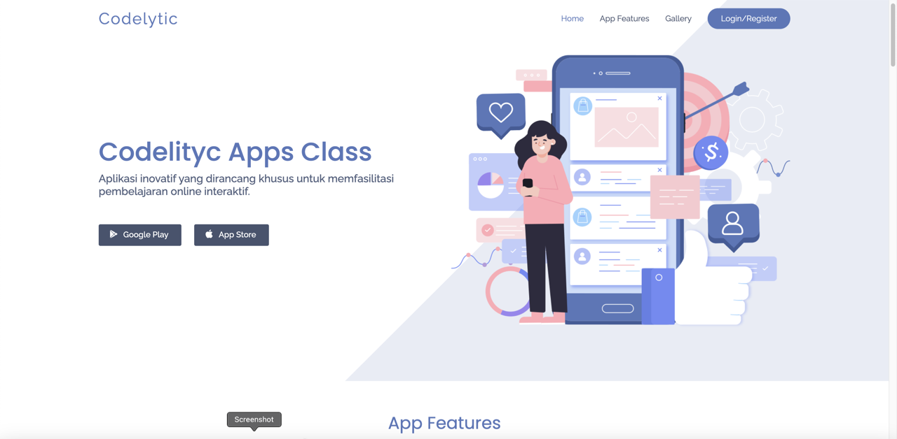
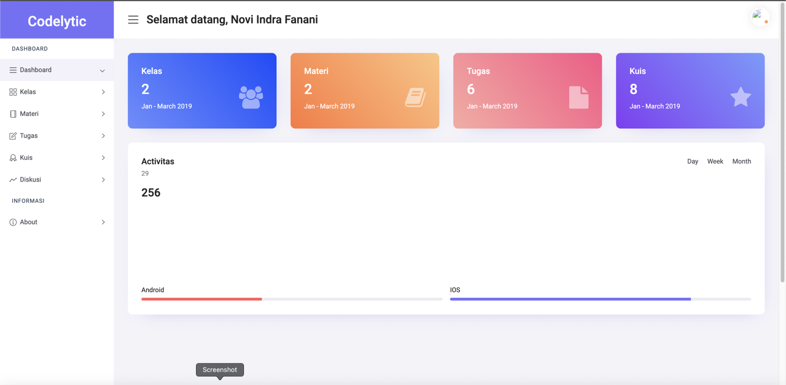
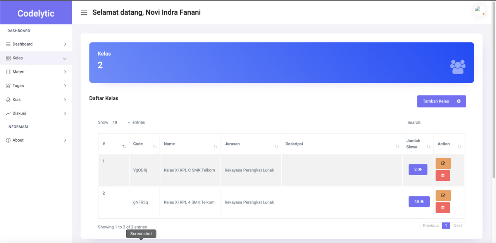
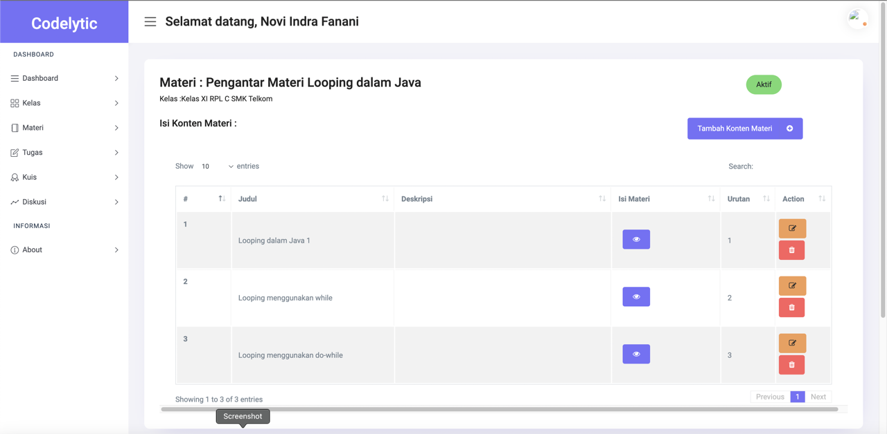
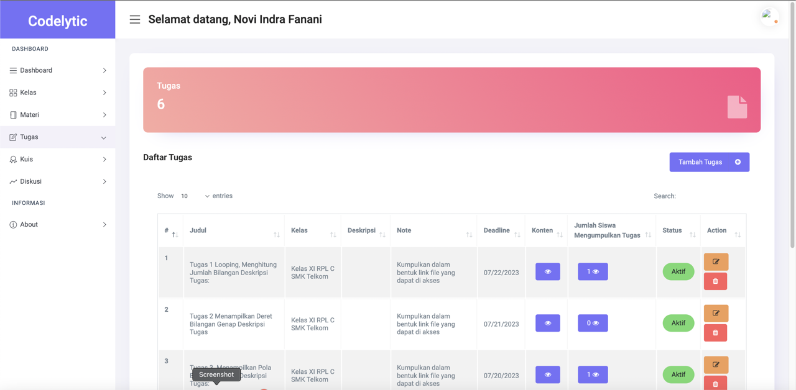
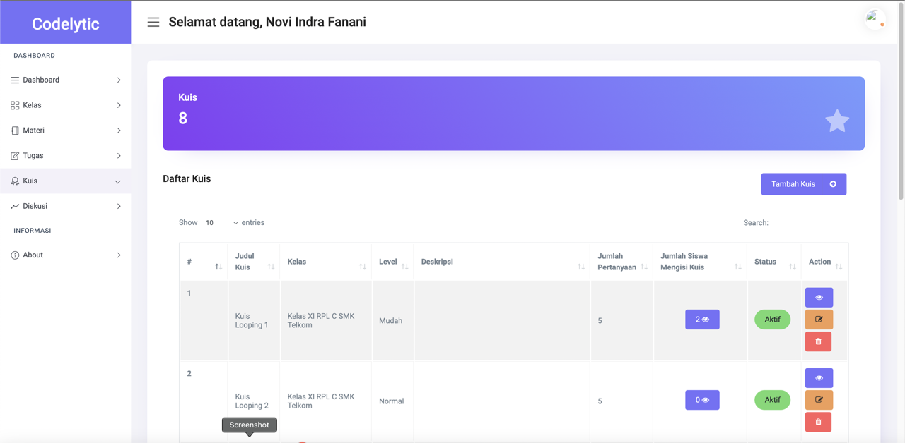
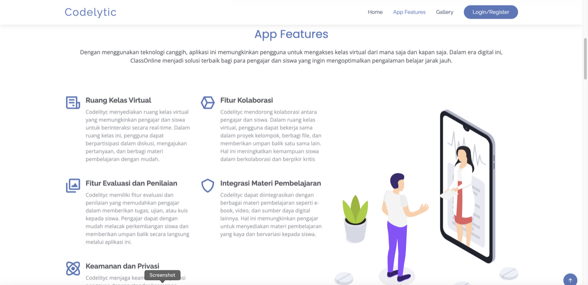

# Codelytic – Teacher Web Dashboard & API

Codelytic is a mobile learning platform for programming classes. This repository is the **Laravel web app**: teachers manage their classes, learning materials, tasks, quizzes and group discussions in a dashboard, and the same backend exposes a **REST API** used by the student mobile app ([codelytic_flutter](https://github.com/NoviIndraF/codelytic_flutter)).



## Features

**Teacher dashboard (web)**
- Register and log in as a teacher.
- **Classes (rooms):** each class gets a short join code that students enter in the mobile app.
- **Materials and chapters:** write chapter content in a rich text editor (CKEditor) with image upload, and publish or hide each material.
- **Tasks:** create assignments with a deadline and review student submissions.
- **Quizzes:** multiple-choice quizzes grouped by difficulty level, with per-student results and answer details.
- **Discussions:** create discussion topics and student groups, and moderate group comments (hide/show).
- Dashboard with totals for classes, materials, tasks and quizzes.

**API for the mobile app**
- Student register / login with token authentication (Laravel Sanctum).
- Join a class or group by code.
- Fetch materials, chapters, tasks and quizzes per class; submit tasks and quiz answers.
- Send and hide comments in group discussions; update the student profile.

## Screenshots

| Dashboard | Classes |
|---|---|
|  |  |
| **Material and chapters** | **Tasks** |
|  |  |
| **Quizzes** | **Landing page features** |
|  |  |

## Tech stack

- Laravel 8, PHP 7.3+ / 8.0
- Laravel Fortify (authentication), Laravel Sanctum (API tokens)
- MySQL
- Blade templates, CKEditor
- `cviebrock/eloquent-sluggable` for slugs

## Getting started

Requirements: PHP 7.3–8.1, Composer, MySQL.

```bash
composer install
cp .env.example .env          # set DB_DATABASE, DB_USERNAME, DB_PASSWORD
php artisan key:generate
php artisan migrate --seed    # creates the tables and sample data
php artisan serve
```

- Web dashboard: http://127.0.0.1:8000 (register a teacher account at `/register`)
- API base URL: http://127.0.0.1:8000/api/ (from an Android emulator: `http://10.0.2.2:8000/api/`)

The seeder fills every table with fake data; seeded users have the password `password`.

## Project structure

```
app/Http/Controllers/   Web dashboard controllers + API endpoints (Student*, *ByRoomId, show*)
app/Models/             Room, Materi, Chapter, Task, Quiz, Question, Discussion, Group,
                        Student, StudentRoom, StudentTask, StudentQuiz, StudentGroup, StudentGroupComment
app/Policies/           Authorization per resource
database/migrations/    Tables for classes, materials, tasks, quizzes, discussions and student data
database/seeders/       Sample data
resources/views/        landingpage/, authentication/, dashboard/, api/ (chapter and discussion pages shown in the app)
routes/web.php          Dashboard routes
routes/api.php          Mobile app API
public/uploads/         Images uploaded from the editor
```

## Related

- Student mobile app (Flutter): [NoviIndraF/codelytic_flutter](https://github.com/NoviIndraF/codelytic_flutter)
